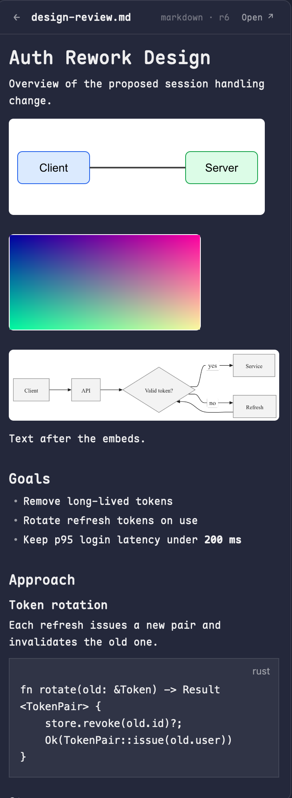

# Cairn for Herdr

A [Herdr](https://herdr.dev) mod: a side panel that follows the Artifacts cairn holds for the focused space's project. It opens by itself when an Artifact is new or gets a new Revision, and shows that Artifact: markdown (with embedded images and diagrams), images, and diagrams, plus its comment Threads.



[`cairn/`](cairn/) is the shareable folder: `mods/cairn/`, the [`RECIPE.md`](cairn/RECIPE.md) a build is written from, and `preview.png`.

## What it needs

- `cairn` (this repo's binary). The mod runs `cairn list`, `get`, `embeds`, `comment list`, `comment add` (with `ID@REV` and `--reply`), `comment resolve|reopen` and `view` in the space's folder, so cairn's project scoping decides which Artifacts show. It needs the `embeds` command and `get --out` for diagrams, so use a cairn built from this repo at or after those commits.
- `mod.json` sets `"focusable": true` so `pane.go` can give the panel the keyboard for the inline comment composer.
- A layout with a side panel: a stack with id `panel-body` inside a column with id `panel`, holding a block `{ "id": "cairn", "content": { "mod": "cairn" } }`. Herdr's `main` layout has the `panel` and `panel-body` nodes (Files and Changes). Add a `cairn` child to `panel-body`, and a tab-bar button that selects it:

  ```js
  run("layout.select", { stack: "panel-body", child: "cairn" });
  run("layout.show", { id: "panel" });
  ```

  Herdr's shipped layouts and the `tabs` mod are read-only, so clone them (`herdr-app do layout.clone`, `herdr-app do mod.clone`) and edit the clones. The `tabs` mod's `panelButton("changes", ...)` line is the one to copy for a Cairn button.
- "Open" in the panel header opens the web UI, so run `cairn serve` for that. Everything else reads sqlite directly and needs no server.

## Install by hand

Copy `cairn/mods/cairn/` to `~/.config/herdr-app/mods/cairn/` and run `herdr-app check ~/.config/herdr-app/mods/cairn`. The mod looks for `cairn` on `PATH`.

## Install with nix

The flake exports `packages.<system>.herdr-mod`: the mod laid out as a Herdr home's `mods/` folder, with its cairn binary pinned to the same flake's `cairn` package.

```nix
# inputs.cairn.url = "github:<owner>/cairn";
home.file.".config/herdr-app/mods/cairn" = {
  source = "${inputs.cairn.packages.${pkgs.system}.herdr-mod}/mods/cairn";
  recursive = true; # Herdr writes jsconfig.json and .d.ts files into mod folders
};
```

Link the folder per file (`recursive = true`) so Herdr can write its own files beside the mod's.

## Use

- Click the Cairn button to toggle the panel. It lists the project's Artifacts, newest activity first. Click one to read it.
- When an Artifact is created or gets a new Revision, the panel opens on it. The first look at a space is a silent baseline, so existing Artifacts do not read as new.
- Header: back to the list, and **Open** to view the Artifact in the web UI (it says so if `cairn serve` is not running).
- html bundles are not drawn: Herdr has no web view. The panel says so, and Open shows them.

- Each comment Thread card has a **Resolve** button (open Threads) or **Reopen** button (resolved Threads), stale Threads included. It runs `cairn comment resolve|reopen` as the reviewer, reloads the Artifact at once, and shows a failure as an inline error on that card.
- Each Thread card also has a **Reply** button, on open, resolved and stale Threads alike. It opens the inline composer under that Thread and Send runs `cairn comment add ID BODY --reply THREAD_ID` as the reviewer; the panel reloads and shows the reply at once. Reply drafts are kept per space, Artifact and Thread.
- Every Artifact of every Kind (markdown, image, diagram, html) has a **Comment on this revision** header button. It opens the inline composer and Send runs `cairn comment add ID@REV BODY` as the reviewer on the latest Revision, with no locator; the panel reloads and shows the whole-revision Thread at once.

The mod writes to cairn only through those reviewer comment actions. Images and diagrams are fetched into `~/.config/herdr-app/data/cairn-cache/<id>@<rev>/` once per Revision.
