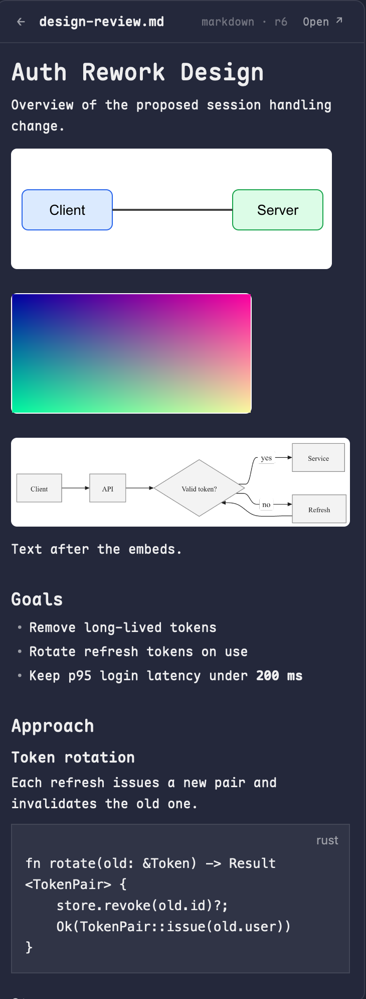

# Cairn

A side panel for Herdr that shows the Artifacts cairn holds for the focused space's project. It opens on its own when an Artifact is new or gets a new Revision, and renders markdown (with embedded images and diagrams), images, diagrams and comment Threads natively.

## What you see

A panel in the layout's right column, sharing it with Files and Changes (a Cairn button sits beside theirs in the tab bar). Rounded 10px card, `theme().background`, 1px `border`, 13px text.

- **Index:** a 42px header "Cairn" with a count chip ("N artifacts") and, when any Thread is open, the total in `theme().blocked` ("N open"). Below it a scrolling list, one 36px row per Artifact: kind (52px, dim, 10px), name (truncated), open Thread count as "N●" in `blocked` when above zero, and "rN · age" (dim, 11px; age is `now`, `Nm`, `Nh`, `Nd`). Empty state: "No artifacts for this project" (or the error text, or "Loading…").
- **Detail:** a 42px header with a back arrow, the name, "kind · rN", and an "Open ↗" button. Below, a scrolling body then a "Comments" block, one bordered card per Thread (border `blocked` while open): author, locator (section path, "line N" or "whole revision"), status and "stale", the body, and replies indented.
  - markdown: `TextView.markdown` segments, with own-line `` embeds drawn as pictures between them.
  - image, svg and mermaid diagram: the picture on a white 1px-bordered rounded tile, scaled to the panel width and never upscaled past its natural size.
  - A diagram that will not render shows its source. An embed that is deleted or cannot be fetched shows "[embedded ID (deleted) or cannot be shown here: alt]" in dim 11px.
  - html: a dim note that bundles are not rendered here.

## How it behaves

- Polls `cairn --json list --limit 200` every 3 s in the active space's folder (the focused pane's `cwd`, else the space's folder). Changing space or folder parks that context's list, "seen" map and open Artifact in memory and restores them on return, so the panel comes back on the same Artifact. A context not visited before starts with a fresh baseline.
- **Auto-open:** the first successful list per space is a baseline. Afterwards an Artifact whose id is new or whose `latest_revision` rose is "changed"; the newest one is shown: `run("layout.select", {stack: "panel-body", child: "cairn"})`, `run("layout.show", {id: "panel"})`, and the detail view loads. While a detail is open it reloads on each poll.
- **Open ↗:** `cairn view ID@REV` gives the web UI URL (honors `CAIRN_URL`); the mod fetches it, and if nothing answers posts a warning toast "Nothing is listening at URL. Run `cairn serve`", else runs `open URL` (falling back to `xdg-open`). On a space from another machine it posts a toast instead.
- **Thread buttons:** each Thread card has a Resolve (open) or Reopen (resolved) button, also on stale Threads. It calls `write()`, which reloads the Artifact on success; on failure the error shows under that card (`writeErrorThread`).
- No keys. Clicks: a row opens that Artifact; the back arrow returns to the list.
- Agent statuses do not apply: this panel does not show agents.

## Built from

- One mod, `mods/cairn/` (`main.js`, `mod.json` = `{ "place": "none" }`, `cairn.svg` for the tab-bar button). Imports `View, div, image` from `gpui-kit`; `v_flex, h_flex, Scrollbar, TextView` from `gpui-base`; `spaces, panes, focused, exec, appHome, run, theme, settings, notify` from `herdr`; `fs/promises`.
- cairn commands, all run with `exec(bin, args, {cwd, on, timeout: 15000})`: `--json list --limit 200`, `get ID@REV` (markdown source), `--json embeds ID@REV` (`line`, `target_id`, `target_revision`, `dangling`, `alt`), `get ID@REV --out DIR` (image and diagram files; a diagram is rendered to `diagram.svg`), `--json comment list ID --all`, `comment resolve|reopen THREAD_ID` (through `write()`, as the reviewer), `view ID@REV`. The binary is `BINS = ["@cairn@", "cairn"]`: the flake replaces `@cairn@` with a store path; unreplaced, it fails and falls back to `cairn` on PATH.
- Pictures: Herdr draws no http or data: images (`TextView` ignores them), only `image(path)` for a file under the app folder. Files are fetched to `data/cairn-cache/<id>@<rev>/` once (revisions are immutable). Natural size comes from the PNG header or the svg `width`/`height`/`viewBox`. The loader does not resolve CSS custom properties and cairn's Mermaid SVG colors everything through them, so each `var(--x, fallback)` in a cached svg is replaced by its literal value before drawing.
- Markdown is split at the embed lines `cairn embeds` reports; an embed that shares a line with other text stays in the text (no inline images in Herdr).
- Layout: a block `{ "id": "cairn", "content": { "mod": "cairn" } }` as a child of the stack `panel-body` in the column `panel`; a tab-bar button that selects it (copy the `tabs` mod's Files and Changes buttons). Shipped layouts and `tabs` are read-only: clone them.

## Watch out

- `TextView.html` and `TextView.markdown` render no images at all; do not use data URIs or http URLs.
- A flex column shrinks images: picture tiles need `flex_none()`.
- Do not write the cache under `mods/`: saving there reloads every copy of the mod.
- Only the active space is polled, so an Artifact created while another space is focused does not open the panel.
- Remote (non-local) spaces: pictures are not fetched (the cache is local) and Open is refused.
- `herdr-app check` does not exercise the layout or a click; open it in the app.

## Done when

- `herdr-app check mods/cairn` passes and `herdr-app status` shows no errors.
- In a repo with cairn Artifacts, the Cairn button opens the index with the right rows.
- `cairn submit` of a new file, or `cairn edit` of one, opens the panel on it within about 6 s with the panel hidden.
- A markdown Artifact with an own-line `` embed of an svg, a png and a mermaid diagram shows three pictures with readable labels.
- "Open ↗" opens the browser when `cairn serve` runs, and shows the warning toast when it does not.
- Clicking Resolve on an open Thread flips it to resolved and the panel reloads; Reopen flips it back; a failure shows an inline error on that card.
- Clicking Comment in an open Artifact's header shows an inline composer. Typed text and caret survive over 6 s (two polls). Escape or Cancel discards the draft; opening another Artifact, going back, or switching space keeps it, and reopening the composer on the same Artifact restores it. A failed Send keeps the draft and shows the error under the box; a good Send posts a whole-revision Thread.
